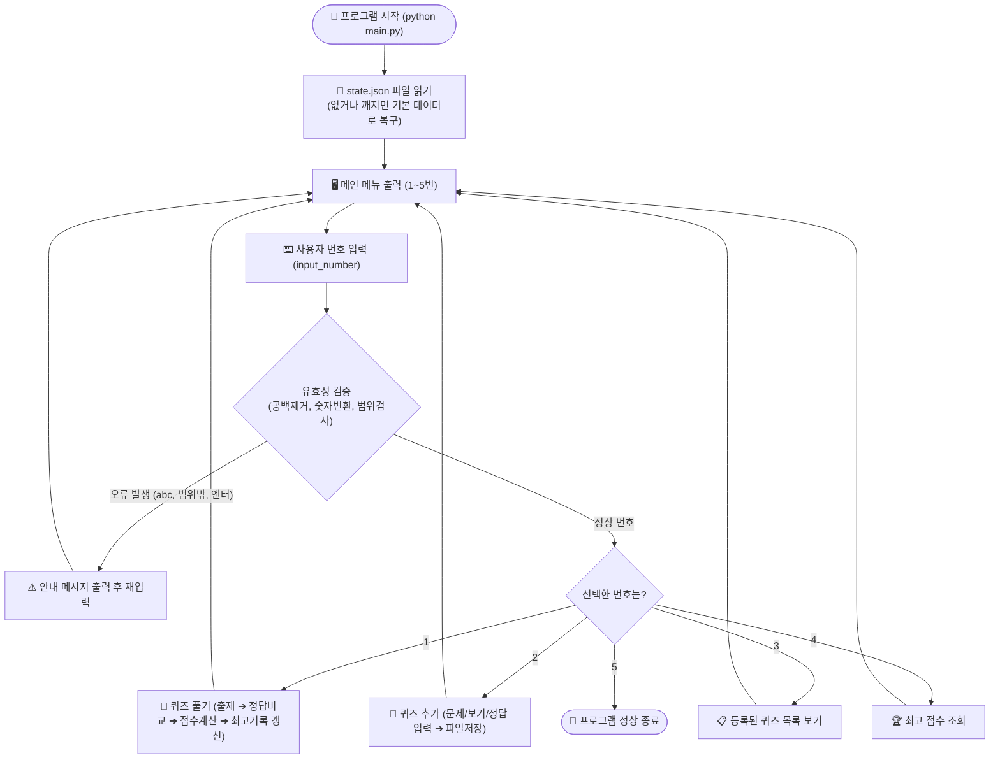
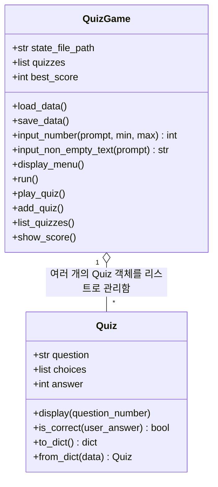

# 📖 나만의 파이썬 & Git 핵심 용어사전 (Cheat Sheet)

> 이 문서는 **Mission 1-2**를 진행하며 등장한 핵심 프로그래밍 및 Git 개념을 초심자의 눈높이에서 쉽게 찾아보고 복습할 수 있도록 정리한 전용 용어사전입니다.

---

## 🎨 1. 시각적 흐름도 (Visual Flowcharts)

### [다이어그램 1] 프로그램 전체 실행 및 게임 제어 흐름


---

### [다이어그램 2] 객체 지향 구조 (Quiz vs QuizGame)


---

## 🐍 2. Python 핵심 문법 용어사전

### ① 변수 (Variable)
* **개념**: 컴퓨터 메모리에 어떤 데이터(값)를 담아두는 **"이름표가 붙은 상자"**입니다.
* **왜 쓰는가**: 매번 데이터를 새로 타이핑하지 않고, 상자의 이름으로 저장된 값을 편리하게 재사용하고 변경하기 위함입니다.
* **코드 예시**:
  ```python
  score = 0            # score라는 상자에 숫자 0을 담음
  score = score + 10   # score에 10을 더해 10으로 갱신
  ```

---

### ② 핵심 기본 자료형 5가지
파이썬에서 다루는 데이터의 5가지 대표적인 생김새입니다:

| 자료형 | 이름 | 설명 | 예시 |
|:---:|:---:|:---|:---|
| `int` | 정수형 | 소수점이 없는 양수, 0, 음수 | `1`, `42`, `-5` |
| `str` | 문자열 | 큰따옴표나 작은따옴표로 감싼 글자 | `"Python"`, `'정답'` |
| `bool` | 불리언 | 참(`True`) 또는 거짓(`False`) 딱 2가지 상태 | `True`, `False` |
| `list` | 리스트 | 순서가 있는 목록형 상자 (수정 가능 `[]`) | `["사과", "바나나", "포도"]` |
| `dict` | 딕셔너리 | '이름(Key)'과 '값(Value)'이 짝을 이루는 사전형 상자 (`{}`) | `{"name": "퀴즈", "score": 100}` |

---

### ③ 조건문: `if / elif / else`
* **개념**: 상황(조건)이 참이냐 거짓이냐에 따라 서로 다른 코드를 실행하는 **"갈림길"**입니다.
* **왜 쓰는가**: "사용자가 1번을 누르면 퀴즈를 풀고, 5번을 누르면 게임을 끝내라"처럼 컴퓨터에게 상황별 판단력을 주기 위함입니다.

---

### ④ 반복문: `for` vs `while`
* **`for` 루프**: **개수나 범위가 정해져 있을 때** 사용합니다.
  * 예: "등록된 5문제의 퀴즈를 순서대로 1문제씩 가져와서 풀어라"
* **`while` 루프**: **어떤 조건이 만족될 때까지 끝없이 반복**할 때 사용합니다.
  * 예: "사용자가 올바른 숫자(1~5)를 입력할 때까지 계속해서 다시 물어봐라 (`while True`)"

---

### ⑤ 함수 (Function)와 메서드 (Method)
* **함수 (`def`)**: 자주 반복되는 일련의 코드 동작을 하나로 묶어둔 **"전용 자판기"**입니다.
  * **매개변수(Parameter)**: 자판기에 넣는 동전이나 재료 (예: `prompt`, `min_val`)
  * **반환값(Return)**: 자판기가 작업을 마치고 밖으로 뱉어내는 완성된 결과물 (예: 검증된 숫자)
* **메서드**: 특정 클래스(객체) 내부에 소속되어 그 객체를 위해서 일하는 함수를 메서드라고 부릅니다.

---

### ⑥ 클래스 (Class)와 객체 (Object)
* **클래스**: 붕어빵을 찍어내는 **"틀(설계도)"** (예: `class Quiz:`)
* **객체(인스턴스)**: 그 설계도를 바탕으로 실제로 만들어진 **"실제 붕어빵"** (예: `q1 = Quiz(...)`)
* **`__init__`**: 객체가 태어날 때 처음 딱 한 번 호출되는 **"탄생 기념 세팅 메서드(생성자)"**
* **`self`**: 지금 막 만들어진 **"자기 자신 붕어빵"**을 가리키는 대명사
* **속성(Attribute)**: 그 객체가 가지고 있는 데이터/변수 (문제 내용, 정답 번호 등)

---

### ⑦ 파일 입출력 및 JSON 영속성
* **`open(..., "r", encoding="utf-8")`**: 한글이 깨지지 않도록 UTF-8 표준으로 파일을 읽거나 쓰는 기본 함수.
* **`with` 구문**: 파일을 열고 작업이 끝나면 깜빡하고 닫지 않아도 **자동으로 안전하게 파일을 닫아주는 문법**.
* **JSON (`JavaScript Object Notation`)**:
  * 사람이 읽기 편하고 다른 언어(자바스크립트 등)와도 데이터를 주고받기 쉬운 세계 표준 텍스트 데이터 형식.
  * `json.dump()`: 파이썬 데이터를 JSON 텍스트 파일로 저장.
  * `json.load()`: JSON 파일의 글자를 읽어서 파이썬 리스트/딕셔너리로 변환.
* **`try / except` (예외 처리)**:
  * 에러가 발생할 만한 위험한 작업(예: 파일 읽기, 숫자 변환)을 시험해보고(`try`), 문제가 터지면 프로그램이 멈추지 않고 비상 대책(`except`)을 실행하는 안전장치.

---

## 🌿 3. Git 핵심 7종 명령어 사전

| 명령어 | 실무 의미 | 비유 |
|:---|:---|:---|
| **`git init`** | 현재 폴더를 Git 저장소로 초기화 | 프로젝트 전용 일기장 첫 장 펴기 |
| **`git add`** | 변경된 파일을 커밋 대기 영역(Staging Area)에 올림 | 사진 찍기 전 피사체를 무대 위에 세우기 |
| **`git commit`** | 대기 중인 파일들의 상태를 스냅샷으로 영구 기록 | 현재 무대 모습을 사진으로 찰칵 찍어 앨범에 남기기 |
| **`git push`** | 내 로컬 컴퓨터의 기록을 GitHub 원격 저장소로 업로드 | 내 앨범 사진을 인터넷 클라우드에 백업하기 |
| **`git pull`** | GitHub 원격 저장소의 최신 변경사항을 내 컴퓨터로 가져오기 | 클라우드에 새로 올라온 사진을 내 스마트폰으로 내려받기 |
| **`git checkout`** | 다른 브랜치나 이전 시점의 커밋으로 이동 | 타임머신을 타고 다른 작업 공간으로 이동하기 |
| **`git clone`** | 원격 저장소의 전체 코드와 히스토리를 내 컴퓨터로 통째로 복제 | 인터넷에 공개된 프로젝트 전체를 통째로 복사해오기 |
